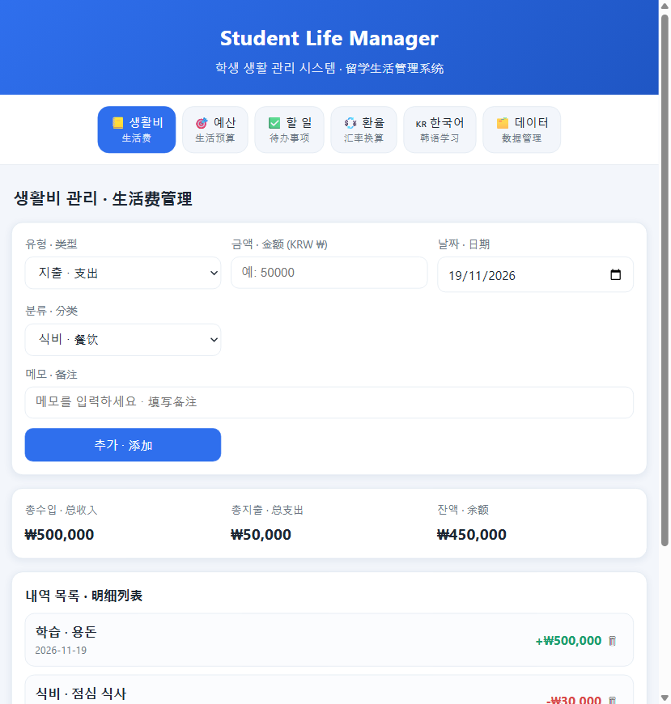
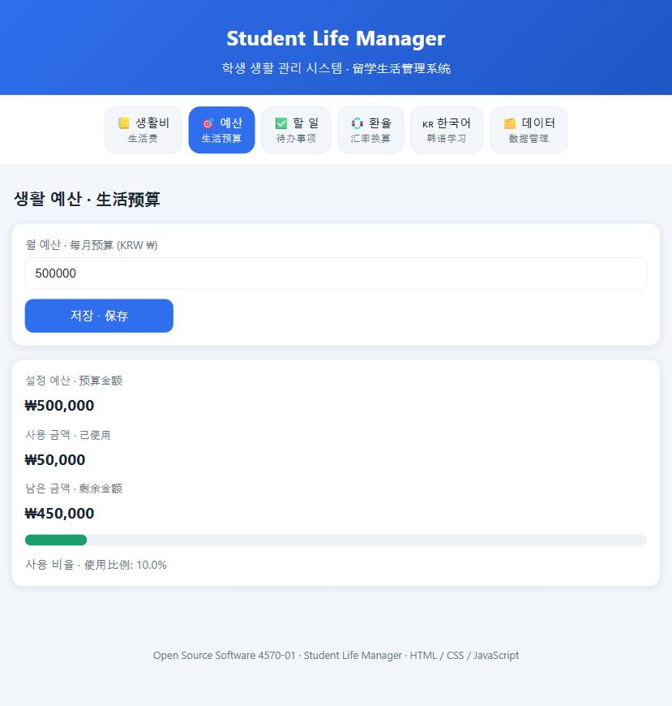
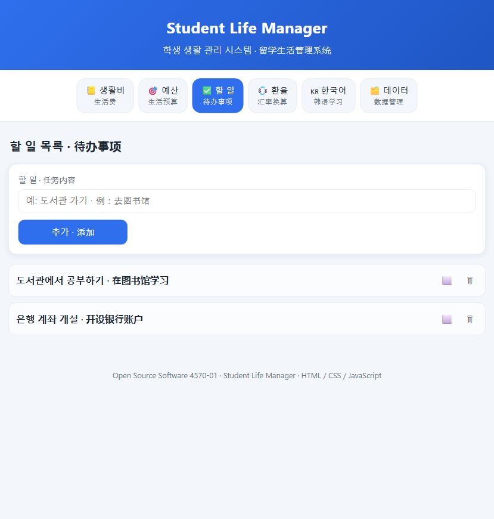
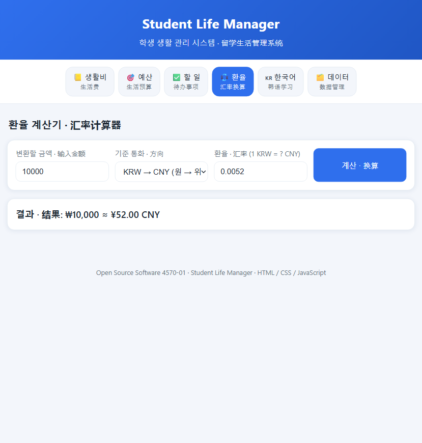
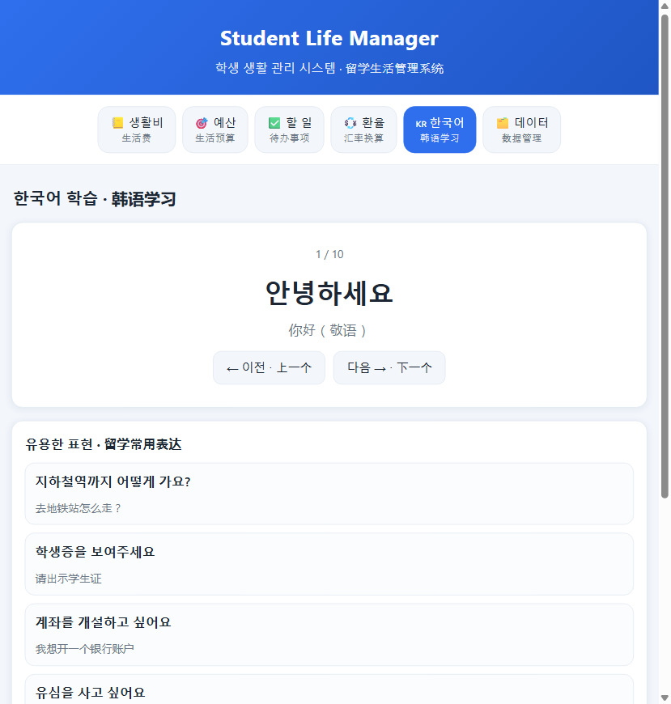

# Student Life Manager · 학생 생활 관리 시스템 · 留学生活管理系统

> Open Source Software 4570-01 (대구대학교 / 大邱大学) 과제 · Assignment

纯前端（HTML / CSS / JavaScript）韩中双语留学生活管理工具，无需服务器或付费 API。
A bilingual (Korean / Chinese) student life management web app built with plain HTML, CSS and JavaScript — no server, no paid API.

## 📋 기능 · 主要功能 · Features

| 기능 · 功能 | 설명 · 说明 |
| --- | --- |
| 생활비 관리 · 生活费管理 | 添加收入/支出，记录金额、日期、分类与备注，自动计算余额。 |
| 생활 예산 · 生活预算 | 设置每月预算，显示已使用金额、剩余金额与使用比例。 |
| 할 일 목록 · 待办事项 | 添加、编辑、删除任务，标记完成状态。 |
| 환율 계산기 · 汇率计算器 | 用户输入 KRW/CNY 汇率，韩元 ⇄ 人民币双向换算。 |
| 한국어 학습 · 韩语学习 | 韩语单词卡片（韩语 + 中文解释）与留学常用表达。 |
| 데이터 관리 · 数据管理 | 浏览器 localStorage 本地保存；支持 JSON 导出 / 导入与清空。 |
| 반응형 · 响应式 | 桌面与手机屏幕下布局均正常。 |

## 🛠️ 기술 스택 · 技术栈 · Tech Stack

- HTML5 · CSS3 · Vanilla JavaScript (ES6+)
- 本地存储：`localStorage`
- 无框架、无构建步骤、无后端依赖

## 🚀 실행 방법 · 运行方法 · How to Run

1. 下载或克隆本仓库到本地。
2. 直接双击 `index.html`，用浏览器（Chrome / Edge）打开即可。
3. 如需本地服务器（可选）：
   ```bash
   # 在项目目录下
   python -m http.server 8000
   # 浏览器访问 http://localhost:8000
   ```

## 📂 프로젝트 구조 · 项目结构

```
student-life-manager/
├── index.html      # 主页面 · Main page
├── style.css       # 样式 · Styles
├── script.js       # 逻辑与数据 · Logic & data
├── README.md       # 说明文档 · This file
├── .gitignore
└── screenshots/    # 运行截图 · Screenshots
```

## 🖼️ 스크린샷 · 截图

| 首页 · 홈 | 生活费 · 생활비 |
| --- | --- |
|  |  |

| 预算 · 예산 | 待办 · 할 일 |
| --- | --- |
|  |  |

| 汇率 · 환율 | 韩语 · 한국어 |
| --- | --- |
|  |  |

## 🌐 언어 · 语言

界面主要标题、菜单、按钮、提示与结果均为韩语 + 中文并列显示。
All main titles, menus, buttons, hints and results are shown bilingually in Korean and Chinese.

## 👤 제출자 · 提交人

- GitHub: `sjkang`
- Email: `sjkang@daegu.ac.kr`
